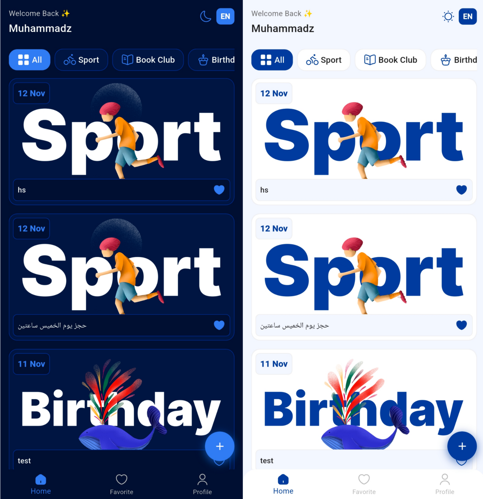
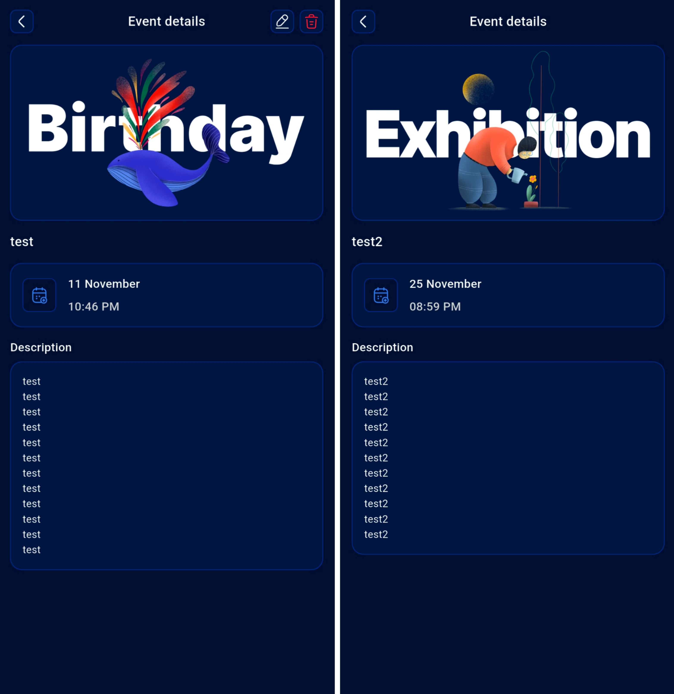
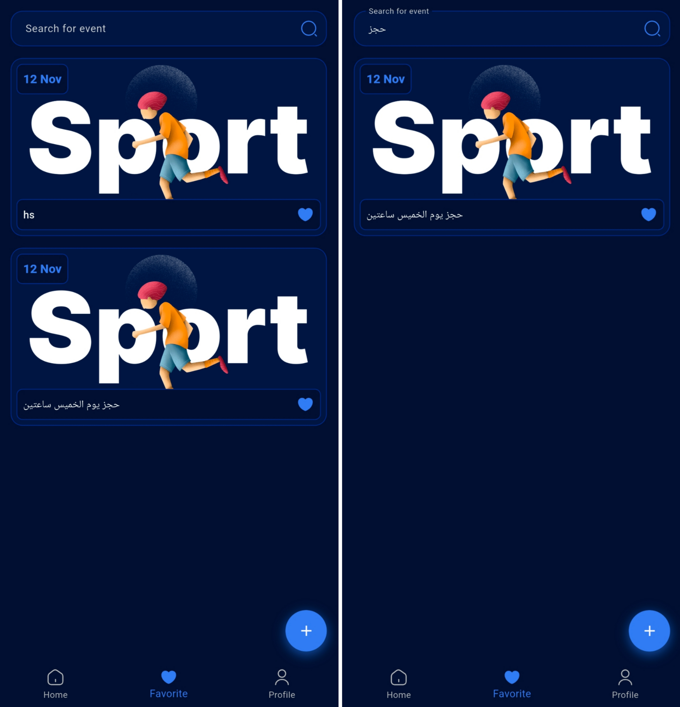
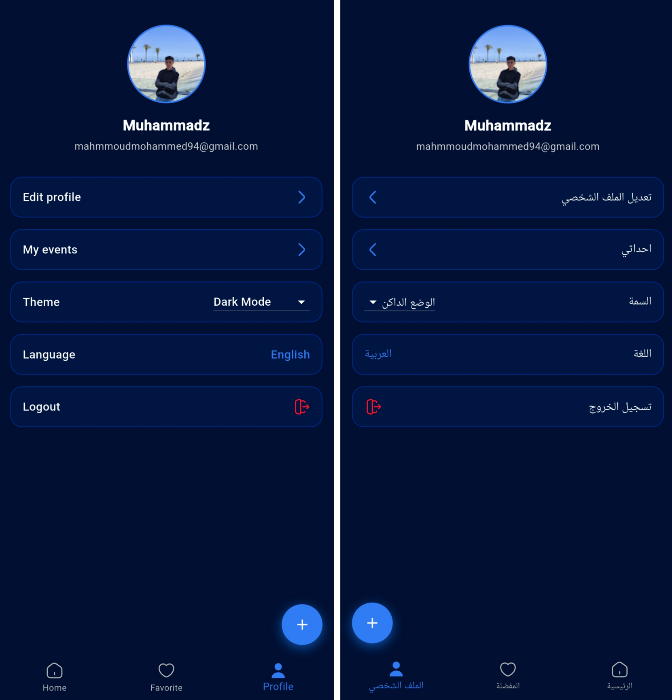
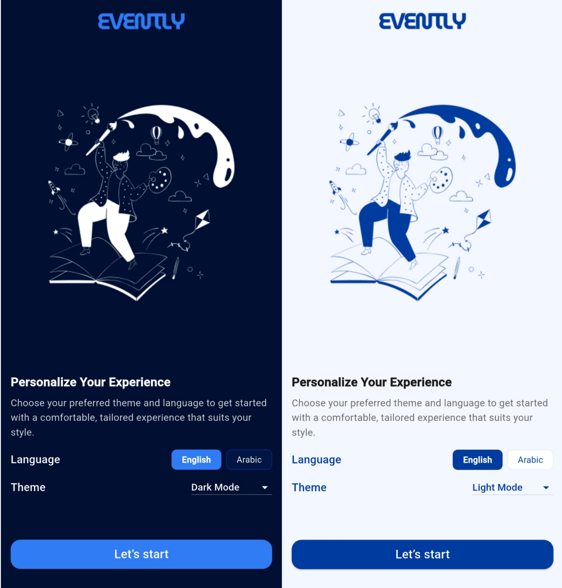

# Evently

**Discover events, save your favorites, and plan your next gathering.** Evently is a Flutter app for browsing and managing events, with Firebase authentication and real-time event updates.

## Key Features

- **Authentication** — Sign in and sign up with email/password or Google.
- **Account management** — Reset passwords, edit profile details, and change passwords.
- **Event management** — Create, edit, view, and delete events with a category, date, and time.
- **Real-time event updates** — Event data is stored and streamed from Cloud Firestore.
- **Favorites** — Save events to your favorites and search them by title or description.
- **My Events** — View events created by your account.
- **Localization** — English and Arabic interfaces.
- **Theme selection** — Switch between light, dark, and system themes.
- **Onboarding** — Choose your language and theme when you first open the app.

## Tech Stack & Architecture

- **Framework:** Flutter
- **Language:** Dart
- **State management:** Provider
- **Backend:** Firebase Authentication and Cloud Firestore
- **Local settings:** SharedPreferences
- **Localization:** Flutter localization with ARB resource files
- **Key packages:**
    - `firebase_core`, `firebase_auth`, `cloud_firestore`
    - `google_sign_in`
    - `provider`
    - `shared_preferences`
    - `flutter_localizations`, `intl`
    - `flutter_svg`, `cached_network_image`
    - `smooth_page_indicator`

The app separates its main concerns into screens and reusable widgets, providers for app state, services for Firebase and local persistence, and models for app data.

## Project Structure

```text
lib/
├── main.dart
├── l10n/
│   ├── app_en.arb
│   ├── app_ar.arb
│   └── generated localization files
├── models/
│   ├── category_dm.dart
│   ├── event_dm.dart
│   ├── onboarding_dm.dart
│   └── user_dm.dart
├── providers/
│   ├── language_provider.dart
│   ├── theme_provider.dart
│   └── user_provider.dart
├── services/
│   ├── auth_service.dart
│   ├── event_service.dart
│   └── shared_prefs_service.dart
└── ui/
    ├── screens/
    │   ├── auth/
    │   ├── edit_profile/
    │   ├── event_details/
    │   ├── main/
    │   ├── my_events/
    │   └── onboarding/
    ├── utils/
    └── widgets/
```

## Getting Started

### Prerequisites

- Flutter SDK compatible with the Dart SDK constraint in `pubspec.yaml`
- A configured Android or iOS development environment
- A Firebase project

### 1. Clone the repository

```bash
git clone https://github.com/mrmuhammedz/evently.git
cd evently
```

### 2. Install dependencies

```bash
flutter pub get
```

### 3. Run the app

Connect a device or start an emulator, then run:

```bash
flutter run
```

To check the project with the Dart analyzer:

```bash
flutter analyze
```

## Screenshots

| Home                                                                                       | Event Details                                                                                             | Favorites                                                                                |
| ------------------------------------------------------------------------------------------ | --------------------------------------------------------------------------------------------------------- | ---------------------------------------------------------------------------------------- |
|  |  |  |

| Profile                                                                                    | Onboarding                                                                                     |
| ------------------------------------------------------------------------------------------ | ---------------------------------------------------------------------------------------------- |
|  |  |
